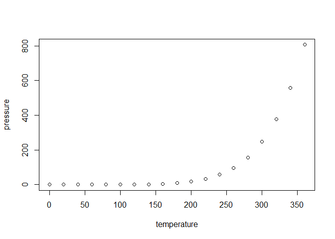

Prolog Asteriod - juypter notebooks
================
miltonwater
30 October, 2026

Roughly speaking, a predicate is recursively defined if one or more
rules in its definition refers to itself.

Troubleshooting Juypter and Quatro notebooks in R Studio.

``` batch
python -m pip install PyYAML
python -c "import nbformat; print(nbformat.__version)"
python -m jupyter --version
python -m pip install PyYAML nbformat nblient nbconvert
py -3.12 -m pip show pyyaml
py -3.14 -m pip show pyyaml
```

The principles of physics are the basis of all modern technology, and
understanding the concepts of physics and knowing how to solve physics
problems is a key indicator of success in advanced study in all
technical fields, including biology, medicine, and the health sciences.

\*\* Installing R Package Dependencies for Python/Reticulate: ‘png’,
‘reticulate’

## venv - jupyter

``` bash
#rm -rf .venv
py -3.12 -m venv .venv
source .venv/Scripts/activate
python -m pip install --upgrade pip
py -m pipx install black
py -m pipx install jupyter
py -m pip freeze
```

<https://dev.to/olgabraginskaya/12-steps-to-organize-and-maintain-your-python-codebase-for-beginners-18bb>

## Requirements

pygame <https://www.pygame.org/wiki/GettingStarted>

Git (Git for windows) <https://git-scm.com/downloads> Python 3.12
<https://www.python.org/downloads/> Optional IDE (PyCharm)
<https://www.jetbrains.com/pycharm/download/> =======

## Installation guide

``` bash
# launch
git clone https://github.com/hedskul/python-oop-pygame-r-reticulate-quarto.git
# TODO: rename repo
cd python-oop-pygame-r-reticulate-quarto
# nuke renv (optional)
#rm -rf .venv
# init venv
py -3.12 -m venv .venv
## had to change to windows / for it to work in bash ##
source .venv/Scripts/activate
# win
.venv\Scripts\activate
# unix/macos
#source .venv/bin/activate

python -m pip install --upgrade pip
pip install pygame
pipx install black
python -m pip freeze > requirements.txt
# run example
python src/hello-world-pygame.py
```

# Virtual environment

``` bash
# init venv
#rm -rf .venv
py -3.12 -m venv .venv
## had to change to windows / for it to work in bash ##
source .venv/Scripts/activate
# win
#.venv\Scripts\activate
# unix/macos
#source .venv/bin/activate
python -m pip install --upgrade pip
pip install pygame black
python -m pip freeze > requirements.txt
```

``` bash
# edit venv
## had to change to windows / for it to work in bash ##
source .venv/Scripts/activate
# win
#.venv\Scripts\activate
# unix/macos
#source .venv/bin/activate
pip install pygame black
#python -m pip install -r src/samples/movies-class-requests/requirements.txt
python -m pip freeze > requirements.txt
```

``` bash
# nuke cache
#rm -rf __pycache__
#rm -rf .pyc
```

``` bash
# add library
.venv/Scripts/activate
pip install requests
pip freeze > src/samples/movies-class-requests/requirements.txt
```

## README is created using rmarkdown, knitr, and renv

This is an R Markdown format used for publishing markdown documents to
GitHub. When you click the **Knit** button all R code chunks are run and
a markdown file (.md) suitable for publishing to GitHub is generated.

1: Install R <https://cran.rstudio.com/>

2: Install RStudio RStudio requires R 3.6.0+. Choose a version of R that
matches your computer’s operating system.
<https://posit.co/download/rstudio-desktop/>

3 Recreate RStudio environment. RStudio: File -\> Open Project Browse to
projectrstudio.Rproj

**File - Open Project**

4 R Console:

``` r
# restore r environment
install.packages("renv")
renv::restore()
```

# R environment

``` r
# init r environment
install.packages("renv")
#??renv::init
#auto.snapshot <- getOption("renv.config.auto.snapshot")
#options(renv.config.auto.snapshot = FALSE)
renv::init(bare = TRUE)
#renv::init()
#renv::settings$snapshot.type("explicit")
#renv::consent(provided = TRUE)
#renv::activate()
## SCOPE AGAIN !!!
renv::activate(project = getwd())
renv::install(c("rmarkdown", "knitr"), prompt=FALSE)
# renv::snapshot(prompt=FALSE)
renv::snapshot()
renv::status()
```

``` r
# edit r environment
renv::activate()
install.packages(c("magrittr", "stringi", "stringr"), quiet=TRUE)
renv::snapshot()
renv::status()
```

## NUKE renv

``` r
# nuke renv
renv::deactivate()
```

# Quit Rstudio

``` bash
# force remove folder files 
rm -rf renv/
rm -f renv.lock
#rm -f .Rprofile
```

# r-reticulate-python

``` r
# include Python
renv::install(
    c(
        "tidyverse",     
        "readxl",        
        "reticulate",    
        "knitr",         
        "rmarkdown"      
    )
)
```

## Including Code

You can include R code in the document as follows:

``` r
summary(cars)
```

    ##      speed           dist       
    ##  Min.   : 4.0   Min.   :  2.00  
    ##  1st Qu.:12.0   1st Qu.: 26.00  
    ##  Median :15.0   Median : 36.00  
    ##  Mean   :15.4   Mean   : 42.98  
    ##  3rd Qu.:19.0   3rd Qu.: 56.00  
    ##  Max.   :25.0   Max.   :120.00

## Including Plots

You can also embed plots, for example:

<!-- -->

Note that the `echo = FALSE` parameter was added to the code chunk to
prevent printing of the R code that generated the plot.

# `{r a} # R #`

# `{python b} # Python #`

# `{dot c} # GraphViz #`

# `{mermaid d} # Mermaid #`

# `{bash e} # Bash #`

# `{julia f} # Julia #`

# `{Rcpp g} # Rcpp #`

# `{sql connection=} # SQL #`

# `{stan output.var=} # Stan #`

.renvignore <https://github.com/rstudio/renv/issues/2033>
