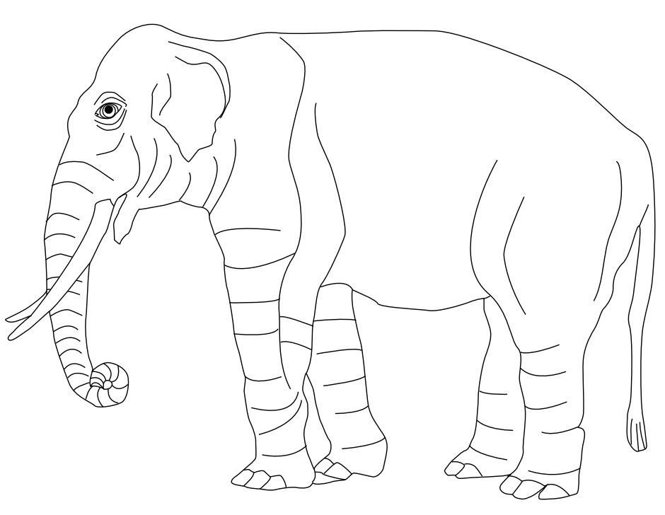

---
### quarto qmd header ###
title: "Prolog && Asteroid - Recursion - prolog(Logic, fundamentals)"
author: "miltonwater"
date: today
format: 
  html: 
    toc: true
    toc-location: left
    self-contained: true
    theme: cosmo

output-dir: _output
code-fold: true
freeze: auto
editor: 
  source: 
    wrap: 72
# engine: knitr
# knitr: true
engine: jupyter
jupyter: python3
---

# Recursion

Rule dataset out: [digestion.pl](/rules/digesting.pl)

```prolog
is_digesting(X,Y):-
    just_ate(X,Y).
is_digesting(X,Y):-
    just_ate(X,Z),
    is_digesting(Z,Y).
just_ate(mosquito,blood(john)).
just_ate(frog,mosquito).
just_ate(stork,frog).
```

```prolog
is_digesting(stork,mosquito).
```

## Installation

For installation instructions, see [Installation
Guide](/installation.qmd).

## Getting Started

Getting your first database running, see [Getting
Started](../getting_started.qmd).

```{python}
import math
print(f"Conservation of momentum")
print(f"Two tired parents")
m1 = 50.0 # kg
m2 = 80.0 # kg
v1i = 1.60
v1f = v2f = vf = 0.200 # m/s
print("m1 * v1i + m2 * v2i = m1 * vf + m2 * vf")
v2i = ((m1 * vf) + (m2 * vf) - (m1 * v1i)) / m2
print(f"v2i: {v2i:.2f} N")
```

## Momentum

$$ p = m * v $$ p is amount of momentum (a vector) m is mass v is amount
of velocity (a vector) units are kg \* m / s units of mass times unit of
velocity

```{python}
import math
mass = m = 1.6 # kg
v_i = 0.700 # m/s
v_f = 0 # STOP
delta_time = 0.250 # seconds
print(f"delta_time: {delta_time:.2f} N")
p_i = m * v_i
P_f = m * v_f
# zero out the stop
delta_p = (m * v_f) - (m * v_i)
print(f"delta_p: {delta_p:.2f} kg*m/s")
f_net = delta_p / delta_time

print(f"f_net: {f_net:.2f} N")
```

## Conservation of momentum

Staying the same.

### Perfectly Inelastic Collisions

"objects stick together"

- no net force on it from things outside of the system.

$$ momentum = m1 * v1i + m2 * v2i = m1 * v1f + m2 * v2f $$

```{python}
import math
print(f"Hockey puck into goalie glove")
print(f"Conservation of momentum")
m1 = 0.150 # kg
m2 = 70 # kg
v1i = 35.0
v2i = 0
print("stick together")
print("v1f = v2f = vf")
print("m1 * v1i + m2 * v2i = m1 * vf + m2 * vf")
print("m1 * v1i + m2 * v2i = (m1 + m2) * vf")
print("(m1 * v1i + m2 * v2i) / (m1 + m2) = vf")

# v1f = 1
# v2f = 1
# obj1 = [m1,v1i,v1f]
# obj2 = [m2,v2i,v2f]

vf = (m1 * v1i + m2 * v2i) / (m1 + m2)
print(f"vf: {vf:.2f} N")

# k_e =  0.5 * m1 * (vi ^ 2) + 0.5 * m2 * (v2i ^ 2)
# k_e_f = 0.5 * m * (vf ^ 2)
```

```{python}
import math

mass = m = 2.00
print(f"Mass: {mass:.2f} kg")
kinetic_friction = f_k = 3.63
print(f"Kinetic friction: {kinetic_friction:.2f} N")
angle_degrees = 20.0 
angle_radians = math.radians(angle_degrees)
cos_theta = math.cos(angle_degrees)
sin_theta = math.sin(angle_degrees)
print("Below horizon rounded:", round(cos_theta, 10))
gravity = g = 9.80 # m / (s ^ 2)
applied_force = F = 5.00
print(f"Applied force: {applied_force:.2f} N")
delta_x = 1.50
print(f"Delta X: {delta_x} m")

work_force = W_F = applied_force * delta_x * cos_theta
print(f"work_force: {work_force:.4f} J")
work_friction = W_f = -kinetic_friction * delta_x
print(f"work_friction: {work_friction:.4f} J")
work_gravity = W_g = 0.0
work_normal = W_N = 0.0

net_work = W_net = work_force + work_friction + work_gravity + work_normal
print(f"net_work: {net_work:.4f} J")
```

find velocity final

```{python}
import math

W_net = 6.76
m = 2.00
```

## Find kinetic friction force

```{python}
import math

mass = 0.498
print(f"Mass: {mass:.1f} kg")
gravity = g = 9.80 # m / (s ^ 2)
force_food = 2.5 # N
coeff_static_friction = mu_k = 0.400
print(f"Kinetic friction: {coeff_static_friction:.3f}")

normal_force = mass * gravity + force_food
print(f"Normal force: {normal_force:.2f}")

kinetic_friction = coeff_static_friction * normal_force
print(f"Kinetic Friction: {kinetic_friction:.4f} N magnitude")
```

## Max friction

```{python}
import math

mass = 75.0
print(f"Mass: {mass:.4f} kg")

applied_force = -320
print(f"Applied force (F): {applied_force:.4f} N")

gravity = g = 9.80 # m / (s ^ 2)

acceleration_x = a_x = 0
print(f"Acceleration X: {a_x:.2f} m/s^2 'Infliction point'")

normal_force = mass * gravity

static_friction_max = abs(applied_force)
print(f"static_friction_max: {static_friction_max:.1f} N")

coeff_static_friction = mu_k = static_friction_max / normal_force
print(f"coeff_static_friction: {coeff_static_friction:.3f}")
```

## Ramp

```{python}
import math

mass = 50.0
print(f"Mass: {mass:.1f} kg")
gravity = g = 9.80 # m / (s ^ 2)
angle_degrees = 10
angle_radians = math.radians(angle_degrees)
cos_theta = math.cos(angle_degrees)
sin_theta = math.sin(angle_degrees)
print("Ramp angle:", round(cos_theta, 10))
print("Sin angle:", round(sin_theta, 10))
coeff_static_friction = mu_k = 0.228
print(f"Kinetic friction: {coeff_static_friction:.3f}")
acceleration_y = a_y = 0
print(f"Acceleration Y: {a_y:.2f} m/s^2 'Perpendicular'")

normal_force = mass * gravity * cos_theta
print(f"Normal force: {normal_force:.2f}")

kinetic_friction = coeff_static_friction * mass * gravity * cos_theta
print(f"kinetic_friction: {kinetic_friction:.4f} N")

net_force_x = kinetic_friction - (mass * gravity * sin_theta)
print(f"Net force X: {net_force_x:.2f} N upward")

acceleration_x = a_x = gravity * (coeff_static_friction * (cos_theta - sin_theta))
print(f"Acceleration X: {acceleration_x:.4f} m/s^2")
```

### Tension && Y Acceleration

```{python}
import math

person2_force = F_3 = 31.8 # N
print(f"Person 2 force X: {person2_force:.4f} N")

mass = m = 10.0
print(f"Mass: {mass:.2f} kg")

gravity = g = 9.80 # m / (s ^ 2)

acceleration_y = a_y = 0.150 # m/s^2
print(f"Acceleration Y: {a_y:.2f} m/s^2")

weight = mass * gravity
print(f"Weight: {weight:.2f} N downward")

net_force_y = mass * acceleration_y
print(f"Net force Y: {net_force_y:.2f} N upward")

tension_force = net_force_y + weight - person2_force
print(f"Tension: {tension_force:.2f} N")

# PROOF
assert abs((tension_force + person2_force - weight) - net_force_y) < 1e-10
```

### Pinball

Up ramp

```{python}
import math
normal_force = 10.7 # N
print(f"Normal force X: {normal_force:.4f} N")

angle_theta = 27.0 # degrees f(x) < x
angle_degrees = angle_theta
angle_radians = math.radians(angle_degrees)
cos_theta = math.cos(angle_degrees)
sin_theta = math.sin(angle_degrees)
print(f"Angle theta: {angle_theta:.2f} deg")

gravity = 9.80 # m / (s ^ 2)

acceleration_y = a_y = 0
print(f"Acceleration Y: {a_y:.2f} m/s^2 'Perpendicular'")

mass = normal_force / (gravity * cos_theta)
print(f"Mass: {mass:.2f} kg")
```

### Elevator && Weight

Positive y direction is upward

```{python}
import math

normal_force = N = 431 # N
print(f"Normal force X: {normal_force:.4f} N")

mass = m = 65.0
print(f"Mass: {mass:.2f} kg")

gravity = g = 9.80 # m / (s ^ 2)

weight = mass * gravity
print(f"Weight: {weight:.2f} N 'magnitude'")

net_force_y = normal_force - weight
print(f"Net force Y: {net_force_y:.2f} N")

acceleration_y = a_y = net_force_y / mass
print(f"Acceleration Y: {a_y:.2f} m/s^2")
```

## Gravity

force of gravity is called weight w = m \* g w is weight m is mass g is
gravity \# meters per second squared

```{python}
import math

g = -9.80 #m/s^2

```

## Tension

same force just opposite direction \<----\> \*\* what is the magnitude
of friction? \*\*

```{python}
f = 0
breeze_right = 10 # newtons
g = 9.8 #m/s^2
m = 155 # kg 
tension = 1.0
a_x = 0
a_y = 0
F_net_x = -f
# division by zero
try:
    F_net_y = m / a_y 
except ZeroDivisionError:
    # limit approaches infinity
    F_net_y = float('inf') 
print(F_net_y)
t = (m * g) - 1400
print("t: ",t)
f = f + breeze_right
print("f: ",f)
print(155 * 9.8 - 1400)
```

## SciPy

SciPy at Geeks for geeks
<https://www.geeksforgeeks.org/python/scipy-constants/#google_vignette>

```{python}
import scipy
print(scipy.__version__)
```

```{python}
import scipy.constants as const

print("Pi:", const.pi)
print("Golden ratio:", const.golden_ratio)
print("Speed of light:", const.c)
print("Gravitational constant:", const.G)
print("Gas constant (R):", const.R)
print("Boltzmann constant:", const.k)
print("Proton mass:", const.proton_mass)
```

## Tension

same force just opposite direction \<----\> \*\* what is the magnitude
of friction? \*\*

```{python}
f = 0
breeze_right = 10 # newtons
g = 9.8 #m/s^2
m = 155 # kg 
tension = 1.0
a_x = 0
a_y = 0
F_net_x = -f
# division by zero
try:
    F_net_y = m / a_y 
except ZeroDivisionError:
    # limit approaches infinity
    F_net_y = float('inf') 
print(F_net_y)
t = (m * g) - 1400
print("t: ",t)
f = f + breeze_right
print("f: ",f)
print(155 * 9.8 - 1400)
```

### References

#### Angles and trig

```{python}
import math
angle_degrees = 90
angle_radians = math.radians(angle_degrees)
cos_theta = math.cos(angle_degrees)
print("cos of 90 degrees (rounded):", round(cos_theta, 10))
# if math.isclose(cos_theta, 0.0, abs_tol=1e-10):
#     cos_theta = 0.0
```

#### Netwon's 2nd law

```{python}
# newtons 2nd law
mass = 70.0 # kg
acceleration_x = 1.23 # m/s^2

F_net_x = mass * acceleration_x

print(f"Net force: {F_net_x:.2f} N")
```

#### Mass on mars

```{python}
g_earth = 9.80  # m/s^2
g_mars = 3.70   # m/s^2

mass = 20.0     # kg

weight_earth = mass * g_earth
weight_mars = mass * g_mars

print(f"{'Planet':<10}{'Gravity (m/s^2)':<20}{'Weight (N)':<12}")
print(f"{'Earth':<10}{g_earth:<20.2f}{weight_earth:<12.2f}")
print(f"{'Mars':<10}{g_mars:<20.2f}{weight_mars:<12.2f}")
```

#### SciPy

SciPy at Geeks for geeks
<https://www.geeksforgeeks.org/python/scipy-constants/#google_vignette>

```{python}
import scipy
print("scipy version: ", scipy.__version__)

import scipy.constants as const
print("SciPy version:", scipy.__version__)
print("Pi:", const.pi)
print("Speed of light (m/s):", const.c)
print("Gravitational constant:", const.G)
print("Gas constant:", const.R)
print("Boltzmann constant:", const.k)
print("Proton mass (kg):", const.proton_mass)
```

```{python}
#kinematics
v_0 = 0.0               # m/s
acceleration_x = 1.23   # m/s^2
time = 2.5               # seconds

v_f = v_0 + acceleration_x * time
delta_x = v_0 * time + 0.5 * acceleration_x * time**2

print(f"Final velocity: {v_f:.2f} m/s")
print(f"Displacement: {delta_x:.2f} m")
```

7.  Lab report structure Purpose: What the experiment investigates.
    Procedure: Steps followed during the experiment. Tables:
    Measurements and recorded observations. Calculations: Formulas,
    substitutions, units, and results. Uncertainty or percent error:
    Compare experimental and accepted values when appropriate.
    Conclusion: Restate the purpose, summarize findings, and discuss
    sources of error.

### quarto - jupyter - python

Jupyter is available in this Python installation. Install with:

``` bash
#rm -rf .venv
py -3.13 -m venv .venv
source .venv/Scripts/activate
python -m pip install --upgrade pip
py -m pip install jupyter
py -m pip freeze
```

## Running Code

When you click the **Render** button a document will be generated that
includes both content and the output of embedded code. You can embed
code like this:

```{python}
1 + 1
```

You can add options to executable code like this

```{python}
#| echo: false
2 * 2
```

To print, press . To open an existing new
project, press
.

{.lightbox}

# Markdown Basics

## Equations

\[Quarto -
Equations\]<https://quarto.org/docs/authoring/markdown-basics.html#equations>

inline math: $E = mc^{2}$

display math:

$$E = mc^{2}$$

## Text Formatting

\[Quarto - Text
Formatting\]<https://quarto.org/docs/authoring/markdown-basics.html#text-formatting>

*italics*, **bold**, ***bold italics***

superscript^2^ / subscript~2~

`verbatim code`

## Heading 2

### Heading 3

#### Heading 4

##### Heading 5

###### Heading 6

<https://quarto.org>

[Quarto](https://quarto.org)


[](https://quarto.org)

[](https://quarto.org)

[{fig-alt="Alt text"}](https://quarto.org)

- unordered list

  - sub-item 1
  - sub-item 2
    - sub-sub-item 1

- item 2

  Continued (indent 4 spaces)

1.  ordered list

2.  item 2

    i)  sub-item 1
        A.  sub-sub-item 1

3.  ordered list

4.  item 2

    A.  sub-sub-item 1

- [ ] Task 1
- [x] Task 2

::: {}
1.  A list
:::

::: {}
1.  Followed by another list
:::

term

: definition

> Blockquote

```{mermaid}
flowchart LR
  A[Hard edge] --> B(Round edge)
  B --> C{Decision}
  C --> D[Result one]
  C --> E[Result two]
```



page 1



page 2

| Line Block
|   Spaces and newlines
|   are preserved

::: classname
Div
:::

::: border
This content can be styled with a border
:::

```         
<div class="border">
  <p>This content can be styled with a border</p>
</div>
```

:::: {#special .sidebar}
::: warning
Here is a warning.
:::

More content.
::::

```         
<div id="special" class="sidebar">
  <div class="warning">
    <p>Here is a warning.</p>
  </div>
  <p>More content.</p>
</div>
```

[This is *some text*]{.class key="val"}

```         
[This is *some text*]{.class key="val"}
```

[This is good]{#id .class key1="val1" key2="val2"}

```         
[This is good]{#id .class key1="val1" key2="val2"}
```

::: callout-note
Note that there are five types of callouts, including: `note`, `tip`,
`warning`, `caution`, and `important`.
:::

```         
:::{.callout-note}
Note that there are five types of callouts, including: 
`note`, `tip`, `warning`, `caution`, and `important`.
:::
```

endash: --

emdash: ---

# Markdown Basics

## Equations

\[Quarto -
Equations\]<https://quarto.org/docs/authoring/markdown-basics.html#equations>

inline math: $E = mc^{2}$

display math:

$$E = mc^{2}$$

## Text Formatting

\[Quarto - Text
Formatting\]<https://quarto.org/docs/authoring/markdown-basics.html#text-formatting>

*italics*, **bold**, ***bold italics***

superscript^2^ / subscript~2~

`verbatim code`

## Heading 2

### Heading 3

#### Heading 4

##### Heading 5

###### Heading 6

<https://quarto.org>

[Quarto](https://quarto.org)



[](https://quarto.org)

[](https://quarto.org)

[{fig-alt="Alt text"}](https://quarto.org)

- unordered list

  - sub-item 1
  - sub-item 2
    - sub-sub-item 1

- item 2

  Continued (indent 4 spaces)

1.  ordered list

2.  item 2

    i)  sub-item 1
        A.  sub-sub-item 1

3.  ordered list

4.  item 2

    A.  sub-sub-item 1

- [ ] Task 1
- [x] Task 2

::: {}
1.  A list
:::

::: {}
1.  Followed by another list
:::

term

: definition

> Blockquote

```{mermaid}
flowchart LR
  A[Hard edge] --> B(Round edge)
  B --> C{Decision}
  C --> D[Result one]
  C --> E[Result two]
```



page 1



page 2

| Line Block
|   Spaces and newlines
|   are preserved

::: classname
Div
:::

::: border
This content can be styled with a border
:::

```         
<div class="border">
  <p>This content can be styled with a border</p>
</div>
```

:::: sidebar
::: warning
Here is a warning.
:::

More content.
::::

```         
<div id="special" class="sidebar">
  <div class="warning">
    <p>Here is a warning.</p>
  </div>
  <p>More content.</p>
</div>
```

[This is *some text*]{.class key="val"}

```         
[This is *some text*]{.class key="val"}
```

[This is good]{.class key1="val1" key2="val2"}

```         
[This is good]{#id .class key1="val1" key2="val2"}
```

::: callout-note
Note that there are five types of callouts, including: `note`, `tip`,
`warning`, `caution`, and `important`.
:::

```         
:::{.callout-note}
Note that there are five types of callouts, including: 
`note`, `tip`, `warning`, `caution`, and `important`.
:::
```

endash: --

emdash: ---
